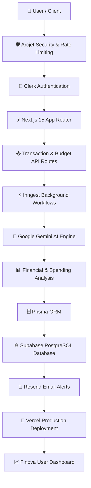
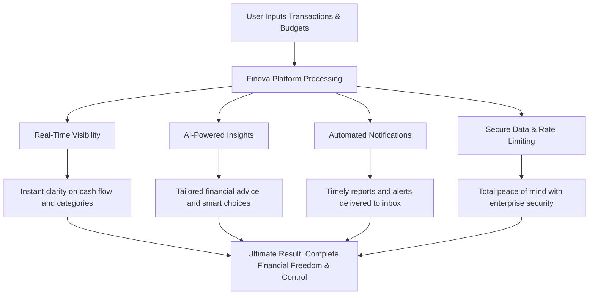

### Finova — AI-Powered Financial Management Platform

> **Smart tracking. Intelligent insights. Total financial control.**


Finova is a modern, full-stack **AI-powered financial management platform** designed to track expenses, manage budgets, and analyze spending habits seamlessly.

It translates complex financial logs and categorization data into clear, actionable advice for users asking one core question:

> **How can I optimize my spending and secure my financial future?**

---

## 💡 Overview & The Solution

Managing personal finances effectively requires more than just static spreadsheets. **Finova** bridges the gap by combining relational database storage with real-time AI insights, automated background event queues, and robust enterprise-grade security to deliver a complete financial workspace.

---

## 🛠️ Tech Stack & Architecture

- **Framework:** Next.js 15 (App Router), React, TypeScript
- **Styling & UI:** Tailwind CSS, Shadcn UI
- **Database & ORM:** Supabase PostgreSQL, Prisma ORM
- **Authentication & Security:** Clerk, Arcjet (Bot protection & rate limiting)
- **AI & Automation:** Google Gemini API, Inngest (Background workflows)
- **Communications:** Resend (Transactional emails)
- **Deployment:** Vercel

---

## 🔄 Complete System Workflow

The complete Finova workflow, from user authentication to AI-powered financial insights and database persistence:




## 🚀 Quick Start & Local Setup

### Prerequisites

Ensure you have the following installed on your system:
- **Node.js** (v18 or higher)
- **npm**, **pnpm**, or **yarn**
- **Git**

---

### 1. Clone the Repository

```bash
git clone [https://github.com/Zishan-125/Finova.git](https://github.com/Zishan-125/Finova.git)
cd Finova
```
### Make sure to create a `.env` file with following variables -

```
DATABASE_URL=
DIRECT_URL=

NEXT_PUBLIC_CLERK_PUBLISHABLE_KEY=
CLERK_SECRET_KEY=
NEXT_PUBLIC_CLERK_SIGN_IN_URL=/sign-in
NEXT_PUBLIC_CLERK_SIGN_UP_URL=/sign-up
NEXT_PUBLIC_CLERK_AFTER_SIGN_IN_URL=/onboarding
NEXT_PUBLIC_CLERK_AFTER_SIGN_UP_URL=/onboarding

GEMINI_API_KEY=

RESEND_API_KEY=

ARCJET_KEY=
```
